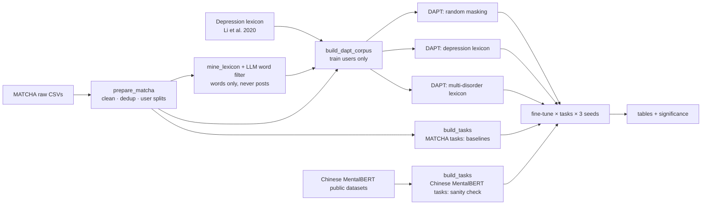

<div align="center">

# MATCHA-Bench

**Baselines for multi-disorder mental health detection on Chinese social media:<br>Chinese MentalBERT's lexicon-guided pre-training, reproduced on MATCHA**

[](https://www.python.org/)
[](https://pytorch.org/)
[](https://github.com/huggingface/transformers)
[](LICENSE)
[](data/README.md)

</div>

---

## Overview

[MATCHA](https://doi.org/10.36227/techrxiv.176685818.81296428/v1) (Li et al., 2025) is the first
**multi-disorder** Chinese Weibo dataset: 1.8M posts from 41.8k users across seven DSM-5 disorders
(ADHD, ASD, bipolar, depression, GAD, OCD, schizophrenia) plus controls. It is descriptive only: it
releases no tasks, splits or baselines.

This repository builds those **baselines**. It defines detection tasks on MATCHA and measures how
well established methods do on them. The scores are the reference point that new methods for MATCHA
are compared against; a new method is planned as follow-up work.

The first method reproduced is [Chinese MentalBERT](https://aclanthology.org/2024.findings-acl.629/)
(Zhai et al., Findings of ACL 2024). It continues the pre-training of a Chinese BERT on Weibo
mental-health posts, with a **depression lexicon deciding which words get masked**. Its pre-training
corpus is private and covers depression only. Here the same recipe is run on MATCHA.

## Roadmap

| Step | What | Status |
|---|---|---|
| 1a | **Chinese MentalBERT on MATCHA.** Pre-train on MATCHA training users, fine-tune on the MATCHA tasks, and check the reproduction on the paper's own tasks. | Done (results below) |
| 1b | **LLM baseline** following [MentalGLM](https://github.com/zwzzzQAQ/MentalGLM) (Zhai et al.): LoRA instruction tuning of a ~9B Chinese LLM on the MATCHA tasks | Planned |
| 2 | **A new method**, evaluated against the step-1 baselines | Planned |

## Pipeline



## Experimental design

**Pre-training variants.** All variants share the same corpus cache, segmentation and
hyper-parameters, so they differ only in which words get masked.

| Tag | Masking | Lexicon | Role |
|---|---|---|---|
| `matcha-random` | whole-word, 20% | none | control: effect of the MATCHA corpus alone |
| `matcha-depression` | lexicon-guided, 20% | Li et al. (2020), 1,470 words | **the Chinese MentalBERT recipe** |
| `matcha-multidisorder` | lexicon-guided, 20% | MATCHA-mined, 2-LLM consensus, 7 disorders, 520 words ([details](docs/LEXICON.md)) | optional variant |

**Models.**

| Model | Chinese MentalBERT tasks | MATCHA tasks |
|---|:---:|:---:|
| `tfidf-lr` (char 1–3-gram, CPU) | ✓ | ✓ |
| `bert-base-chinese` | ✓ | not run (trails `bert-wwm-ext` on every sanity-check task; dropped to save GPU time) |
| `hfl/chinese-bert-wwm-ext` (the starting point of every DAPT variant) | ✓ | ✓ |
| `zwzzz/Chinese-MentalBERT` (the released model) | ✓ | ✓ |
| `matcha-random`, `matcha-depression` | ✓ | ✓ |
| `matcha-multidisorder` | ✓ | not yet |

**MATCHA tasks (the baselines).** Defined in this repository, since MATCHA has none. The pipeline
runs the four **core** tasks. The other three are built too, but paused to save GPU time; add them
back in [`configs/pipeline.yaml`](configs/pipeline.yaml).

| Task | Level | Labels | Metric | Question | Run |
|---|---|---|---|---|:---:|
| `matcha_disorder_post` | post | 7 | macro-F1 | which disorder community does the post come from? | core |
| `matcha_disorder_post_masked` | post | 7 | macro-F1 | the same, with disorder and drug names hidden | core |
| `matcha_user_binary_masked` | user | 2 | macro-F1 | disorder vs control, from **homepage posts only**, names hidden | core |
| `matcha_user_multiclass_masked` | user | 8 | macro-F1 | 7 disorders + control, from **homepage posts only**, names hidden | core |
| `matcha_user_binary` / `matcha_user_multiclass` | user | 2 / 8 | macro-F1 | the user-level tasks without masking | paused |
| `matcha_ip_post` | post | 2 | binary F1 | is the post an explicit self-report of diagnosis or treatment? | paused |

**Chinese MentalBERT tasks (sanity check).** These are the paper's own evaluation tasks. Scores
close to the published ones show that the reproduction works.

| Task | Level | Labels | Metric | Source |
|---|---|---|---|---|
| `suicide` | post | 2 | binary F1 | SOS-HL-1K |
| `cognitive` | post | 12 (multi-label) | micro-F1 | SocialCD-3K |
| `ewect_epidemic` | post | 6 emotions | macro-F1 | SMP2020-EWECT |
| `waimai` | post | 2 | binary F1 | food-delivery reviews (non-mental-health control) |
| `ewect_usual` | post | 6 emotions | macro-F1 | SMP2020-EWECT; stopped after 7 of 18 runs to save GPU time |
| `c2d2` | post | 8 | macro-F1 | optional; data shared on request |

Every number is reported as mean ± std over 3 seeds, with paired-bootstrap significance tests.

**Leakage controls.**
- A single **user-level** split (70/10/20, stratified by cohort) is shared by every task and by the
  DAPT corpus. Pre-training sees **training-split users only**.
- 766 "control" users who also post in disorder communities are removed from the control group.
- User-level tasks use homepage timelines only, because Super-Topic posts name the disorder.
- `_masked` variants replace disorder names, community nicknames and 60+ psychiatric drug names
  with placeholders (`某病`, `某药`). Comparing `matcha_disorder_post` with its masked twin shows how
  much of a score comes from spotting those words.

## Results (stage 1)

Test scores, mean ± std over 3 seeds (seeds 42–44). The full tables are written to `outputs/results/`
(`summary_f1.csv`, `all_runs.csv`, one `significance_*.csv` per comparison).

**MATCHA baselines** (macro-F1):

| Model | `disorder_post` | `disorder_post_masked` | `user_binary_masked` | `user_multiclass_masked` |
|---|---|---|---|---|
| `tfidf-lr` | 48.8 | 39.6 | 90.1 | 41.7 |
| `bert-wwm-ext` | 51.6 ± 0.8 | 42.3 ± 1.5 | 91.6 ± 0.6 | 49.3 ± 1.5 |
| `chinese-mentalbert` | 51.6 ± 3.3 | 43.7 ± 2.0 | 90.5 ± 0.9 | 50.3 ± 1.0 |
| `matcha-random` | 51.5 ± 2.6 | **45.2 ± 1.9** | 91.5 ± 1.0 | 51.5 ± 1.0 |
| `matcha-depression` | 51.3 ± 2.1 | 44.9 ± 1.9 | **92.1 ± 0.7** | **52.3 ± 0.4** |

- **Pre-training on MATCHA helps where names are hidden.** `matcha-random` beats `bert-wwm-ext` by
  2.9 points on `disorder_post_masked` and 2.2 on `user_multiclass_masked` (significant for 2 of 3
  seeds on each; paired bootstrap, p < 0.05). With names visible, all BERT models tie.
- **Lexicon-guided masking adds nothing measurable.** `matcha-depression` vs `matcha-random` is
  within 1 point on every task and significant for none of the 12 task × seed pairs.
- **Much of the unmasked score is keyword spotting.** Hiding disorder and drug names costs 6–9
  points on `disorder_post` for every model. Schizophrenia (F1 40 → 20) and OCD (52 → 39) lose the most.
- **Bipolar disorder and schizophrenia are the hardest classes** (per-class F1 about 20 on
  `disorder_post_masked`, 44 and 20 on `user_multiclass_masked`).
- `user_binary_masked` is close to saturated: TF-IDF already reaches 90.1.

**Sanity check on the Chinese MentalBERT tasks** (F1; Cognitive is micro-F1, EWECT macro-F1):

| Model | Suicide | Cognitive | Waimai | EWECT-epidemic |
|---|---|---|---|---|
| `tfidf-lr` | 75.4 | 63.1 | 82.9 | 59.8 |
| `bert-base-chinese` | 79.8 | 71.9 | 84.5 | 65.2 |
| `bert-wwm-ext` | 80.6 | 73.7 | 84.8 | 65.9 |
| `chinese-mentalbert` | 81.5 | 73.9 | 85.5 | 65.9 |
| `matcha-random` | 81.6 | 74.3 | 84.2 | 65.8 |
| `matcha-depression` | 81.9 | 74.6 | 84.4 | 67.1 |
| `matcha-multidisorder` | 80.6 | 73.6 | 84.7 | 66.7 |

The released Chinese MentalBERT scores 81.5 / 73.9 here, against 81.30 / 74.91 reported in the
MentalGLM paper on slightly different splits, so the fine-tuning setup reproduces. EWECT-usual was
stopped after 7 of 18 runs (`bert-wwm-ext` 75.5, `matcha-random` 76.0, `matcha-depression` 76.3 on one seed).

## Quick start

```bash
git clone https://github.com/shehryars715/matcha-bench.git && cd matcha-bench
pip install -e .                      # or: pip install -r requirements.txt

# 0. data (see data/README.md for MATCHA access)
python scripts/prepare_matcha.py                 # clean + user-level splits
python scripts/download_mentalbert_data.py       # public Chinese MentalBERT downstream datasets
python scripts/build_tasks.py                    # all tasks -> data/tasks/

# 1. lexicons
python scripts/build_depression_lexicon.py       # the paper's depression lexicon
python scripts/mine_lexicon.py                   # candidates from MATCHA (local)
python scripts/filter_lexicon_deepseek.py         # annotator B (key in .env), about $0.26
python scripts/compare_lexicon_annotations.py     # Cohen's kappa between annotators A and B
python scripts/build_multidisorder_lexicon.py     # consensus of A and B -> 520-word lexicon

# 2. pre-training (GPU)
python scripts/build_dapt_corpus.py              # shared cache, train users only
python scripts/run_dapt.py --config configs/dapt/smoke.yaml        # CPU sanity check
python scripts/run_dapt.py --config configs/dapt/random.yaml
python scripts/run_dapt.py --config configs/dapt/depression.yaml
python scripts/run_dapt.py --config configs/dapt/multidisorder.yaml

# 3. evaluation
python scripts/run_tfidf.py                                  # CPU baseline
python scripts/run_finetune.py --tasks all --models all      # resumable
python scripts/summarize_results.py --compare matcha-depression matcha-random
```

`python scripts/run_pipeline.py` runs steps 2–3 in the order set in
[`configs/pipeline.yaml`](configs/pipeline.yaml), including the model comparisons.

**Reproduce in one notebook:** [`notebooks/reproduce_local.ipynb`](notebooks/reproduce_local.ipynb) on a local GPU
(needs the data zip), or [`notebooks/reproduce_kaggle.ipynb`](notebooks/reproduce_kaggle.ipynb) on Kaggle (GPU T4 ×2, Internet on,
`matcha-bench-data` attached). Both have a 5-minute `check` mode and resume after interruptions.

Running on Kaggle from the command line (free T4 ×2): `python scripts/kaggle_pipeline.py start` runs the whole GPU pipeline in
resumable 9-hour sessions (run it again after each session finishes). See [`docs/KAGGLE.md`](docs/KAGGLE.md).

## Reproduction notes

The implementation was checked against the
[Chinese MentalBERT code](https://github.com/zwzzzQAQ/Chinese-MentalBERT). Differences are deliberate and listed here.

| | Chinese MentalBERT | This repo |
|---|---|---|
| Base model, epochs, batch, LR, chunking | `chinese-bert-wwm-ext`, 3, 128, 5e-5, 128 tokens | same |
| Masking budget | `round(0.2 · n_tokens)`, lexicon words first in sentence order, random top-up | same (`select_mask_positions`) |
| Segmentation | LTP | jieba primed with all lexicons, so every variant has identical word boundaries |
| Corpus | 3.36M private posts (depression) | MATCHA training users (7 disorders + control) |
| Downstream test users in pre-training | not controlled | excluded by construction |
| Fine-tuning | lr 2e-5, batch 16, 10 epochs, best dev | same, plus early stopping (patience 3), 3 seeds and significance tests. MATCHA tasks: one run per GPU, batch 16. The sanity-check tasks ran across both Kaggle GPUs, an effective batch of 32. Each run records its `effective_batch_size` in `metrics.json`. |
| Cognitive / Suicide | 5-fold CV | fixed splits matching the paper's sizes (2,180/545/682 and 799/200/250) |

## Repository layout

```
├── configs/                 YAML configs (data, tasks, lexicon, corpus, dapt/*, finetune, pipeline)
├── src/matcha_bench/
│   ├── data/                MATCHA loading, cleaning, user-level splits
│   ├── tasks/               MATCHA and Chinese MentalBERT task builders (one shared on-disk format)
│   ├── lexicon/             depression lexicon, log-odds mining, word filtering
│   ├── pretrain/            corpus packing, lexicon-guided WWM collator, DAPT trainer
│   ├── finetune/            fine-tuning runner and metrics
│   ├── baselines/           TF-IDF + logistic regression
│   ├── stats.py             aggregation over seeds, paired bootstrap
│   ├── terms.py             disorder / drug shortcut masking
│   └── text.py              Weibo text cleaning
├── scripts/                 one CLI per pipeline step, plus run_pipeline.py and Kaggle helpers
├── notebooks/               one-click reproduction (local GPU, Kaggle) and a step-by-step Kaggle notebook
├── tests/                   unit tests (offline, synthetic data)
└── docs/                    research plan, lexicon construction, Kaggle guide
```

## Ethics and data use

- MATCHA contains posts about people's mental health. It is distributed under a DUA for
  non-commercial research. **No data, derived post-level files or lexicons are included here.**
- Only aggregated, k-anonymous candidate **words** are sent to an external LLM. Posts never leave the machine.
- Models trained here detect **community membership and self-disclosure on social media**. They do not
  diagnose anyone and must not be used to screen or label individuals.
- Known biases: disorder cohorts are about 82% female vs 62% of controls; labels for identified-positive
  users come from an LLM and are noisy; ADHD and ASD posts are often written by caregivers.

## Citation

```bibtex
@misc{matchabench2026,
  title  = {MATCHA-Bench: Baselines for Multi-Disorder Mental Health Detection on Chinese Social Media},
  year   = {2026},
  note   = {Code: https://github.com/shehryars715/matcha-bench}
}
```

Please also cite the work this builds on: Chinese MentalBERT (Zhai et al., 2024), MATCHA
(Li et al., 2025), the depression lexicon (Li et al., 2020), and the downstream datasets
(SMP2020-EWECT; Qi et al., 2023; Wang et al., 2023).
