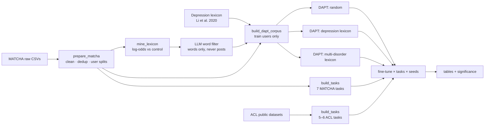

<div align="center">

# MATCHA-Bench

**Lexicon-guided domain-adaptive pre-training and a leakage-aware benchmark for<br>multi-disorder mental health detection on Chinese social media**

[](https://www.python.org/)
[](https://pytorch.org/)
[](https://github.com/huggingface/transformers)
[](LICENSE)
[](data/README.md)

</div>

---

## Overview

[Chinese MentalBERT](https://aclanthology.org/2024.findings-acl.629/) (Zhai et al., Findings of ACL 2024)
showed that continued pre-training of a Chinese BERT on Weibo mental-health posts, with a
**depression lexicon deciding which words get masked**, improves downstream mental-health
classification. Its pre-training corpus is private and covers depression only.

[MATCHA](https://doi.org/10.36227/techrxiv.176685818.81296428/v1) (Li et al., 2025) is the first
**multi-disorder** Chinese Weibo dataset: 1.8M posts from 41.8k users across seven DSM-5 disorders
(ADHD, ASD, bipolar, depression, GAD, OCD, schizophrenia) plus controls. It releases no tasks,
splits or baselines.

This repository connects the two:

1. **Reproduction.** Lexicon-guided DAPT is re-run on an open, gated corpus (MATCHA) and evaluated on the
   public downstream tasks from the ACL paper.
2. **Extension.** A **multi-disorder lexicon** is mined from MATCHA with log-odds statistics and
   kept only where two independent LLM annotators agree ([details](docs/LEXICON.md)). It is compared against random masking and the original
   depression lexicon.
3. **Benchmark.** The first detection tasks on MATCHA, built with **user-level splits**, **contaminated-control
   removal** and **shortcut-masked variants** that hide disorder and drug names. Every number is
   reported as mean ± std over seeds, with paired-bootstrap significance tests.

## Pipeline



## Experimental design

**Pre-training variants.** All variants share the same corpus cache, segmentation and
hyper-parameters, so they differ only in mask selection.

| Tag | Masking | Lexicon | Purpose |
|---|---|---|---|
| `matcha-random` | whole-word, 20% | none | effect of the corpus alone |
| `matcha-depression` | lexicon-guided, 20% | Li et al. (2020), 1,470 words | faithful reproduction |
| `matcha-multidisorder` | lexicon-guided, 20% | MATCHA-mined, 2-LLM consensus, 7 disorders, 520 words | **extension** |

**Baselines.** `tfidf-lr` (char 1–3-gram), `bert-base-chinese`, `hfl/chinese-bert-wwm-ext`,
and the released `zwzzz/Chinese-MentalBERT`.

**Tasks.**

| Task | Level | Labels | Metric | Notes |
|---|---|---|---|---|
| `ewect_usual` / `ewect_epidemic` | post | 6 emotions | macro-F1 | SMP2020-EWECT (ACL paper) |
| `waimai` | post | 2 | binary F1 | food-delivery reviews (ACL paper) |
| `cognitive` | post | 12 (multi-label) | micro-F1 | SocialCD-3K (ACL paper) |
| `suicide` | post | 2 | binary F1 | SOS-HL-1K (ACL paper) |
| `c2d2` | post | 8 | macro-F1 | optional; data shared on request |
| `matcha_ip_post` | post | 2 | binary F1 | explicit self-report of diagnosis or treatment |
| `matcha_disorder_post` (+`_masked`) | post | 7 | macro-F1 | which disorder community a post comes from |
| `matcha_user_binary` (+`_masked`) | user | 2 | macro-F1 | disorder vs control, **homepage posts only** |
| `matcha_user_multiclass` (+`_masked`) | user | 8 | macro-F1 | 7 disorders + control, **homepage posts only** |

**Leakage controls.**
- A single **user-level** split (70/10/20, stratified by cohort) is shared by every task and by the
  DAPT corpus. Pre-training sees **training-split users only**.
- 766 "control" users who also post in disorder communities are removed from the control group.
- User-level tasks use homepage timelines only, because Super-Topic posts name the disorder.
- `_masked` variants replace disorder names, community nicknames and 60+ psychiatric drug names
  with placeholders (`某病`, `某药`).

## Quick start

```bash
git clone https://github.com/shehryars715/matcha-bench.git && cd matcha-bench
pip install -e .                      # or: pip install -r requirements.txt

# 0. data (see data/README.md for MATCHA access)
python scripts/prepare_matcha.py                 # clean + user-level splits
python scripts/download_acl_data.py              # public ACL downstream datasets
python scripts/build_tasks.py                    # all tasks -> data/tasks/

# 1. lexicons
python scripts/build_depression_lexicon.py       # faithful lexicon
python scripts/mine_lexicon.py                   # candidates from MATCHA (local)
python scripts/filter_lexicon_deepseek.py         # annotator B (key in .env), about $0.26
python scripts/compare_lexicon_annotations.py     # Cohen's kappa between annotators A and B
python scripts/build_multidisorder_lexicon.py     # consensus of A and B -> 520-word lexicon

# 2. pre-training (GPU)
python scripts/build_dapt_corpus.py              # shared cache, train users only
python scripts/run_dapt.py --config configs/dapt/smoke.yaml        # CPU sanity check
python scripts/run_dapt.py --config configs/dapt/random.yaml
python scripts/run_dapt.py --config configs/dapt/depression.yaml
python scripts/run_dapt.py --config configs/dapt/multidisorder.yaml

# 3. evaluation
python scripts/run_tfidf.py                                  # CPU baseline
python scripts/run_finetune.py --tasks all --models all      # resumable
python scripts/summarize_results.py --compare matcha-multidisorder matcha-random
```

**Reproduce in one notebook:** [`notebooks/reproduce_local.ipynb`](notebooks/reproduce_local.ipynb) on a local GPU
(needs the data zip), or [`notebooks/reproduce_kaggle.ipynb`](notebooks/reproduce_kaggle.ipynb) on Kaggle (GPU T4 ×2, Internet on,
`matcha-bench-data` attached). Both have a 5-minute `check` mode and resume after interruptions.

Running on Kaggle from the command line (free T4 ×2): `python scripts/kaggle_pipeline.py start` runs the whole GPU pipeline in
resumable 9-hour sessions (run it again after each session finishes). See [`docs/KAGGLE.md`](docs/KAGGLE.md) and
[`notebooks/kaggle_matcha_bench.ipynb`](notebooks/kaggle_matcha_bench.ipynb).

## Reproduction notes

The original implementation was checked against the
[Chinese MentalBERT code](https://github.com/zwzzzQAQ/Chinese-MentalBERT). Differences are deliberate and listed here.

| | Chinese MentalBERT | This repo |
|---|---|---|
| Base model, epochs, batch, LR, chunking | `chinese-bert-wwm-ext`, 3, 128, 5e-5, 128 tokens | same |
| Masking budget | `round(0.2 · n_tokens)`, lexicon words first in sentence order, random top-up | same (`select_mask_positions`) |
| Segmentation | LTP | jieba primed with all lexicons, so every variant has identical word boundaries |
| Corpus | 3.36M private posts (depression) | MATCHA training users (7 disorders + control) |
| Downstream test users in pre-training | not controlled | excluded by construction |
| Fine-tuning | lr 2e-5, batch 16, 10 epochs, best dev | same, plus early stopping (patience 3), 3 seeds, significance tests |
| Cognitive / Suicide | 5-fold CV | fixed splits matching the paper's sizes (2,180/545/682 and 800/199/250) |

## Repository layout

```
├── configs/                 YAML configs (data, tasks, lexicon, corpus, dapt/*, finetune)
├── src/matcha_bench/
│   ├── data/                MATCHA loading, cleaning, user-level splits
│   ├── tasks/               MATCHA and ACL task builders (one shared on-disk format)
│   ├── lexicon/             depression lexicon, log-odds mining, word filtering
│   ├── pretrain/            corpus packing, lexicon-guided WWM collator, DAPT trainer
│   ├── finetune/            fine-tuning runner and metrics
│   ├── baselines/           TF-IDF + logistic regression
│   ├── stats.py             aggregation over seeds, paired bootstrap
│   ├── terms.py             disorder / drug shortcut masking
│   └── text.py              Weibo text cleaning
├── scripts/                 one CLI per pipeline step
├── notebooks/               Kaggle notebook
├── tests/                   unit tests (offline, synthetic data)
└── docs/                    research plan, lexicon construction, Kaggle guide
```

## Ethics and data use

- MATCHA contains posts about people's mental health. It is distributed under a DUA for
  non-commercial research. **No data, derived post-level files or lexicons are included here.**
- Only aggregated, k-anonymous candidate **words** are sent to an external LLM. Posts never leave the machine.
- Models trained here detect **community membership and self-disclosure on social media**. They do not
  diagnose anyone and must not be used to screen or label individuals.
- Known biases: disorder cohorts are about 82% female vs 62% of controls; labels for identified-positive
  users come from an LLM and are noisy; ADHD and ASD posts are often written by caregivers.

## Citation

```bibtex
@misc{matchabench2026,
  title  = {MATCHA-Bench: Lexicon-Guided Domain-Adaptive Pre-training and a Leakage-Aware
            Benchmark for Multi-Disorder Mental Health Detection on Chinese Social Media},
  year   = {2026},
  note   = {Code: https://github.com/shehryars715/matcha-bench}
}
```

Please also cite the work this builds on: Chinese MentalBERT (Zhai et al., 2024), MATCHA
(Li et al., 2025), the depression lexicon (Li et al., 2020), and the downstream datasets
(SMP2020-EWECT; Qi et al., 2023; Wang et al., 2023).
